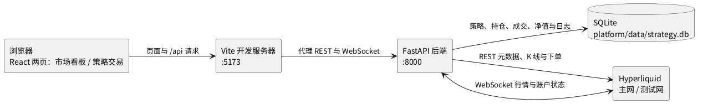

# CryptoGrid 交易平台

本目录是 CryptoGrid 的交易系统工程代码，提供一个面向个人使用的加密货币交易平台。平台分为市场看板与策略交易两个页面，顶部导航在两者之间切换。行情全部实时取自 Hyperliquid，主网对应实盘，测试网对应模拟盘。市场看板只读取公开行情，不接触账户；策略交易会对 `.env` 配置的账户真实下单，并把策略运行数据写入本地 SQLite。

## 功能

市场看板默认展示 BTC 的 1 小时 K 线。用户可以从 Hyperliquid 全部永续合约中选择标的，并在 1m 至 1M 共 14 种周期之间切换，每次加载或切换后展示最近 200 根 K 线，最新一根随行情推送实时更新。K 线图下方带有成交量副图，与主图共享时间轴与缩放。页面分为左右两栏，左栏上方是 K 线图，下方是买单簿与卖单簿两列，各展示 20 档的价格、数量与订单数，买单簿最高买价在最上，卖单簿最低卖价在最上。右栏是交易记录，展示最新的市场公开成交，新成交插入列表顶部，最多保留 50 条，超出可见行数时在面板内竖直滚动。1200 像素以上交易记录与左栏等高，低于 1200 改为单列并限制最大高度。四块面板各带标题并以细边框围住。

市场看板顶部的环境开关切换主网与测试网，切换后所有面板同时改用新环境的数据。周期右侧的展示习惯下拉提供绿涨红跌与红涨绿跌两种配色，切换后 K 线涨跌色、买卖单簿与成交买卖方向的颜色一起改变。其右侧的主题按钮在亮色与暗色之间切换整页风格，默认暗色，K 线图背景同步变化。若当前标的在所选环境中不存在，页面提示标的不可用而不是显示空白。与 Hyperliquid 的连接中断时，页面弹出错误提示并清空面板，后端自动重连，恢复后重新加载并继续实时更新。

策略交易页对一个账户执行多标的 Buy & Hold，具体交互见后文的策略交易章节。

## 界面与适配

两页共用一套设计令牌，默认暗色主题，冷蓝承担主操作与焦点，红绿只用于价格、数量、盈亏与方向文字。字体使用系统字体栈，数字启用等宽数字特性，价格与数量列使用等宽字体。面板以表面色差分与细边框分区，不使用投影；表格只保留横线与悬停整行高亮；方向性信息同时带正负号或买卖文字，不只依赖颜色。亮色主题与绿涨红跌、红涨绿跌切换在页面会话内保留，刷新后恢复默认暗色与绿涨红跌。

布局在 1200 像素以上为双列，交易记录与左侧行情列等高，成交超出可见行数时在面板内部滚动，新成交到达时若用户正在回看则保持滚动位置。低于 1200 改为单列，交易记录高度取视口比例并封顶。375 起全部交易操作可完成，图表与宽表格在各自容器内滚动，不出现整页横向滚动。策略页左侧策略列表在 1024 以下改为顶部横向标签，控制条与参数行在空间不足时整组换行。

K 线图下方为成交量副图，柱色与当根涨跌一致。净值图使用面积线，基准为虚线，最大回撤区间有淡色背景。弹窗限制在视口内并管理键盘焦点，打开时焦点进入弹窗，Tab 在弹窗内循环，Esc 关闭后焦点回到触发按钮。加载、空数据、错误、断线、异常待确认与离线补齐六类状态使用不同的形状与位置，错误提供重试入口。

## 架构

系统由一个 FastAPI 后端和一个 React 前端组成。后端承担两件事：一是作为 Hyperliquid 行情的薄代理，只转发不缓存；二是作为策略引擎，负责建仓、净值采样、持续对账与恢复，并把运行数据写入 SQLite。前端通过 REST 获取元数据与历史数据，通过一条 WebSocket 接收实时推送与策略状态。



后端为每个浏览器连接维护一条到 Hyperliquid 的上游行情 WebSocket。前端发送订阅消息后，后端向上游订阅该标的的 candle、l2Book、trades 三个频道并把推送转交前端。切换标的或周期时在同一条连接上替换订阅；切换环境时关闭旧连接并连接新环境，这一过程不会被当作断线通报。上游意外断开时，后端向前端发送 disconnected 状态，按 1、2、4、8 秒的退避间隔重连，成功后发送 connected 并恢复订阅。

前端的历史 K 线来自后端 REST 接口，后端调用 candleSnapshot 拉取一段足够长的区间后只返回最后 200 根，使各种周期都能得到准确根数。实时推送到达后，图表按时间戳更新最后一根或追加新的一根。

策略引擎在 FastAPI 进程内以异步任务运行。运行中的策略每秒读取一次中间价用于组合估值，每 5 秒落一条净值点；同时订阅 WebSocket 的账户状态频道，每次推送都逐标的比对实际持仓与数据库记录，不一致立即改为异常待确认。后端启动时会先做订单追查与对账，再用历史 K 线补齐离线期间的净值，最后恢复订阅与采样。

## 目录

```text
platform/
├── data/                  # 运行时目录，策略数据库落于此，被 git 忽略
├── backend/
│   ├── main.py            # FastAPI 应用：行情接口、策略路由与启动恢复
│   ├── hl_proxy.py        # 上游 Hyperliquid WebSocket 薄代理
│   ├── db.py              # sqlite3 建表与读写助手
│   ├── trading.py         # 账户解析与下单封装，含 cloid 与手续费补齐
│   ├── strategy_engine.py # Buy & Hold 引擎：建仓、采样、对账、补齐、恢复
│   └── strategy_api.py    # 策略 REST 接口
└── frontend/
    ├── index.html
    ├── package.json
    ├── vite.config.js     # 将 /api 的 HTTP 与 WebSocket 代理到后端
    └── src/
        ├── main.jsx
        ├── App.jsx        # 页面外壳：顶部导航与两页共享的展示习惯与主题
        ├── styles.css     # 设计令牌、布局、组件样式与响应式断点
        ├── api.js         # 行情 REST 与 WebSocket 访问封装
        ├── strategyApi.js # 策略接口封装
        ├── theme.js       # 设计令牌与主题应用
        ├── pages/
        │   ├── MarketDashboard.jsx
        │   └── StrategyTrading.jsx
        └── components/
            ├── Panel.jsx          # 两页共享面板
            ├── Modal.jsx          # 弹窗焦点管理与背景禁用
            ├── Icon.jsx           # 内联矢量图标
            ├── Skeleton.jsx       # 加载骨架
            ├── StatusBlock.jsx    # 空、错误与提示状态块
            ├── CandleChart.jsx    # K 线与成交量副图
            ├── OrderBook.jsx      # 单侧渲染，由父组件分别作买单簿与卖单簿
            ├── TradesList.jsx     # 固定高度滚动与位置保持
            ├── EquityChart.jsx    # 净值、基准与最大回撤带
            ├── RunningStatusBar.jsx # 逐标的持仓状态与失败标的重试
            ├── FillsTable.jsx     # 成交明细，运行中内联与终止后弹窗共用
            └── ProgressTable.jsx  # 执行进度
```

## 策略交易

策略交易页对 `.env` 配置的账户执行多标的 Buy & Hold。页面上方依次为顶部控制条、净值曲线、运行状态栏与交易操作区，左侧是策略列表。顶部控制条水平排列环境、可用余额与刷新、展示习惯与主题，空间不足时整组换行。环境与市场看板页互相独立，展示习惯与主题两页共享，任一处改动另一处同步。

在参数配置中选择基准并为每个标的单独填写投入金额与杠杆，执行预览会列出将要下单的标的、金额、杠杆与名义价值。金额指投入的保证金，名义价值等于金额乘杠杆，须不低于交易所的最小下单额。点击运行后系统逐标的设置逐仓杠杆并以市价买入，每笔成交立即记录。运行期间参数配置、基准与环境整体锁定，展示习惯与主题仍可切换。点击终止会先弹出二次确认，列出将被平仓的标的与数量，确认后按交易所实际持仓市价平仓。部分标的建仓失败时，运行状态栏在对应行显示重试按钮，按原先记录的金额与杠杆补单，不允许修改参数。

运行、终止与重试都会弹出进度弹窗，逐标的显示待提交、提交中、已成交或失败，失败行写明原因。弹窗在操作结束后保留结果由用户关闭，每次操作只自动出现一次。终止的进度弹窗关闭后会弹出本轮成交明细，列出刚结束那轮策略的全部成交。若终止时账户已无实际持仓，则不弹进度弹窗，直接标记为已终止并用顶部横幅说明。进度只存在于进程内存，不写入数据库，后端重启后不保留。

净值曲线展示组合净值、所选基准与最大回撤，纵轴可在绝对金额与收益率百分比之间切换，百分比按初始总投入换算，两种量纲下最大回撤数值一致。策略净值使用面积线，基准使用虚线，最大回撤区间以淡色背景标出。基准为 BTC、ETH、PAXG 的等额买入持有，或按 Hyperliquid USDC 供应利率复利的生息基准；利率接口不可用时沿用最近一次取到的值。基准在运行前选定，运行期间不可更改，需要换基准须终止后重新运行。

运行期间发现某标的被强平或仓位被改动时，策略立即转为异常待确认并停止采样，页面提示差异，等待用户选择按实际持仓继续或平仓终止。后端重启或行情重连后会自动对账、用历史 K 线补齐离线期间的净值并恢复采样。策略不做再平衡，持仓在整个运行期间保持不变。

## 数据与存储

策略、持仓、成交、净值点与运行日志存放在 `platform/data/strategy.db`，使用标准库 sqlite3 并开启 WAL。表结构为 strategy、position、fill、equity_point 与 log 五张，字段说明见 `specs/003-strategy-trading/data-model.md`。该目录被 `.gitignore` 忽略，运行数据不纳入版本控制，删除库文件即可清空全部策略历史。

## 接口

行情侧提供三个接口。`GET /api/instruments?env=` 返回指定环境的全部永续合约名称与数量精度。`GET /api/candles?env=&coin=&interval=` 返回指定标的与周期的最近 200 根 K 线。`WS /api/stream` 接收形如 `{"action": "subscribe", "env": "mainnet", "coin": "BTC", "interval": "1h"}` 的订阅消息，并推送 channel 为 candle、l2Book、trades、status 的消息。env 只接受 mainnet 与 testnet，interval 只接受 14 种周期之一，其它取值返回 400。完整消息格式见 `specs/001-realtime-market-dashboard/contracts/stream.md`。

策略侧在 `/api/strategy` 下提供 account、current、start、retry、stop、resolve、equity、fills、logs 九个接口，另在同一个 WebSocket 上支持 `{"action": "watch_strategy"}` 以推送策略状态。接口语义与请求体见 `specs/003-strategy-trading/contracts/strategy-api.md`。终止后 current 返回 null，成交明细弹窗须用终止前记录的 strategy_id 调用 fills 接口才能取到本轮成交。

## 使用方式

运行前需要安装 uv 与 Node，Python 版本为 3.13，并且本机能够访问 Hyperliquid。市场看板只使用公开行情，不需要密钥；策略交易会真实下单，需要在仓库根目录的 `.env` 中配置 HL_ACC_ADD 与 HL_SECRET_KEY。策略页的环境默认选中测试网，切换主网前请确认金额与标的。

后端的 Python 依赖已写入仓库根目录的 `pyproject.toml`，在仓库根目录启动后端：

```bash
uv sync
uv run uvicorn --app-dir platform/backend main:app --host 127.0.0.1 --port 8000
```

这里使用 `--app-dir` 指定目录，而不是以 `platform.backend.main` 的包路径导入，因为包名 platform 会遮蔽 Python 标准库中的同名模块。首次启动会自动创建 `platform/data/strategy.db` 并建表。

另开一个终端启动前端：

```bash
cd platform/frontend
npm install
npm run dev
```

然后在浏览器中打开 `http://localhost:5173`。Vite 开发服务器会把页面中的 `/api` 请求与 WebSocket 连接转发到 8000 端口的后端，因此需要先启动后端再打开页面。如需生成静态文件，可在 `platform/frontend` 下执行 `npm run build`，产物输出到 `dist/`。

行情部分的端到端验证见 `specs/001-realtime-market-dashboard/quickstart.md`，策略部分的二十条验证场景见 `specs/003-strategy-trading/quickstart.md`。

## 注意事项

后端没有身份认证，只绑定在 127.0.0.1 上，仅供本机访问。若要改为监听其它地址或部署到其它机器，必须先加入访问控制。策略交易持有私钥并在主网真实下单，这一约束尤其重要。

Hyperliquid 的 candleSnapshot 最多只能取到最近 5000 根 K 线，官方也不提供历史 K 线归档，因此看板不适合查看久远的历史行情，长周期回测仍应使用仓库中 `scripts/` 下的数据拉取脚本。测试网部分标的成交稀少，K 线与成交面板可能长时间没有更新，这属于数据源本身的情况，前端不会自行补造 K 线。

账户若为统一账户模式，可用余额由永续可用额度与现货 USDC 余额相加得出，只看永续侧会显示为零。杠杆按标的分别设置且为逐仓，大于一倍时存在被强平风险，系统要等账户状态推送到达后才会发现并转为异常待确认。建议先在测试网用较小金额跑通建仓、终止与恢复，再切到主网。

后续工程计划在此基础上接入网格与门控策略、更完整的风险校验以及 DuckDB 行情存储，当前代码不包含这些功能。
