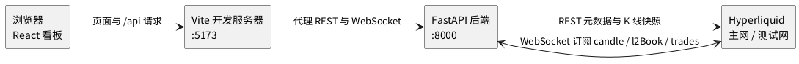

# 实时行情看板

本目录是 CryptoGrid 交易系统的一期工程，提供一个面向个人使用的加密货币实时行情看板。看板展示 Hyperliquid 永续合约的 K 线、订单簿与市场成交，并支持在主网与测试网之间切换，主网对应实盘行情，测试网对应模拟盘行情。一期只做行情展示，不涉及下单、持仓与净值，也不设数据库，所有数据都实时取自 Hyperliquid，不落盘。

## 功能

页面打开后默认展示 BTC 的 1 小时 K 线。用户可以从 Hyperliquid 全部永续合约中选择标的，并在 1m 至 1M 共 14 种周期之间切换，每次加载或切换后展示最近 200 根 K 线，最新一根随行情推送实时更新。页面分为左右两栏，左栏上方是 K 线图，下方是买单簿与卖单簿两列，各展示 20 档的价格、数量与订单数，买单簿最高买价在最上，卖单簿最低卖价在最上。右栏是交易记录，展示最新的市场公开成交，新成交插入列表顶部，最多保留 50 条。买单簿、卖单簿、交易记录三块各带标题并以方框围住。

页面顶部的环境开关用于切换主网与测试网，切换后所有面板同时改用新环境的数据。周期右侧的展示习惯下拉栏提供绿涨红跌与红涨绿跌两种配色，默认绿涨红跌，切换后 K 线涨跌色、买卖单簿与成交买卖方向的颜色一起改变。其右侧的主题按钮在亮色与暗色之间切换整页风格，K 线图背景同步变化。展示习惯与主题的切换只改变颜色，不会清空数据或打断实时更新，刷新页面后恢复默认值。若当前标的在所选环境中不存在，页面会提示该标的不可用，而不是显示空白面板。当后端与 Hyperliquid 的连接中断时，页面弹出错误提示并清空所有面板，后端在后台自动重连，恢复后页面重新加载数据并继续实时更新。

## 架构

系统由一个 FastAPI 后端和一个 React 前端组成。后端是 Hyperliquid 的薄代理，只负责转发，不缓存任何行情状态。前端通过 REST 获取标的列表与历史 K 线，通过一条 WebSocket 接收实时推送。



后端为每个浏览器连接维护一条到 Hyperliquid 的上游 WebSocket。前端发送订阅消息后，后端向上游订阅该标的的 candle、l2Book、trades 三个频道，并把推送原样转交前端。切换标的或周期时，后端在同一条上游连接上替换订阅；切换环境时，后端关闭旧连接并连接新环境，这一过程不会被当作断线通报给前端。上游意外断开时，后端向前端发送 disconnected 状态，按 1、2、4、8 秒的退避间隔重连，成功后发送 connected 并恢复订阅。

前端的历史 K 线来自后端的 REST 接口，后端调用 Hyperliquid 的 candleSnapshot 拉取一段足够长的区间后只返回最后 200 根，这样各种周期都能得到准确的根数。实时推送到达后，图表按时间戳更新最后一根或追加新的一根。

## 目录

```text
platform/
├── backend/
│   ├── main.py        # FastAPI 应用：REST 接口与 WebSocket 端点
│   └── hl_proxy.py    # 上游 Hyperliquid WebSocket 薄代理
└── frontend/
    ├── index.html
    ├── package.json
    ├── vite.config.js # 将 /api 的 HTTP 与 WebSocket 代理到后端
    └── src/
        ├── main.jsx
        ├── App.jsx    # 布局、环境与标的周期选择、展示习惯与主题、连接状态处理
        ├── api.js     # REST 与 WebSocket 访问封装
        ├── theme.js   # 展示习惯与主题到配色的映射
        └── components/
            ├── CandleChart.jsx
            ├── OrderBook.jsx  # 单侧渲染，由父组件分别作买单簿与卖单簿
            └── TradesList.jsx
```

## 接口

后端对前端提供三个接口。`GET /api/instruments?env=` 返回指定环境的全部永续合约名称与数量精度。`GET /api/candles?env=&coin=&interval=` 返回指定标的与周期的最近 200 根 K 线。`WS /api/stream` 接收形如 `{"action": "subscribe", "env": "mainnet", "coin": "BTC", "interval": "1h"}` 的订阅消息，并推送 channel 为 candle、l2Book、trades、status 的消息。env 只接受 mainnet 与 testnet，interval 只接受上述 14 种周期，其它取值返回 400。完整的消息格式见 `specs/001-realtime-market-dashboard/contracts/stream.md`。

## 使用方式

运行前需要安装 uv 与 Node，Python 版本为 3.13，并且本机能够访问 Hyperliquid。一期只使用市场公开数据，不需要 `.env` 中的任何密钥。

后端的 Python 依赖已写入仓库根目录的 `pyproject.toml`，在仓库根目录启动后端：

```bash
uv sync
uv run uvicorn --app-dir platform/backend main:app --host 127.0.0.1 --port 8000
```

这里使用 `--app-dir` 指定目录，而不是以 `platform.backend.main` 的包路径导入，因为包名 platform 会遮蔽 Python 标准库中的同名模块。

另开一个终端启动前端：

```bash
cd platform/frontend
npm install
npm run dev
```

然后在浏览器中打开 `http://localhost:5173`。Vite 开发服务器会把页面中的 `/api` 请求与 WebSocket 连接转发到 8000 端口的后端，因此需要先启动后端再打开页面。如需生成静态文件，可在 `platform/frontend` 下执行 `npm run build`，产物输出到 `dist/`。

端到端的验证步骤见 `specs/001-realtime-market-dashboard/quickstart.md`。

## 注意事项

后端没有身份认证，只绑定在 127.0.0.1 上，仅供本机访问。若要改为监听其它地址或部署到其它机器，必须先加入访问控制。

Hyperliquid 的 candleSnapshot 最多只能取到最近 5000 根 K 线，并且官方不提供历史 K 线归档，因此看板不适合查看久远的历史行情，长周期回测仍应使用项目中 `scripts/` 下的数据拉取脚本。测试网的部分标的成交稀少，K 线与成交面板可能长时间没有更新，这属于数据源本身的情况，前端不会自行补造 K 线。

后续工程计划在此基础上接入网格与门控策略、下单执行、风险校验以及 SQLite 与 DuckDB 存储，一期代码不包含这些功能。
